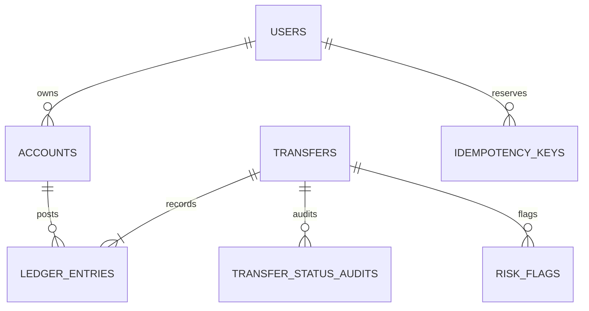

# Schema design

| Noun | Table / decision |
|---|---|
| user, wallet, system account | `users`, `accounts`; an account has zero or one owner |
| transfer, reversal, status history | `transfers`, self-reference `reversal_of_id`, `transfer_status_audits` |
| debit / credit ledger line | `ledger_entries`, immutable and positive paise with separate direction |
| client retry | `idempotency_keys`, unique per user and body hash |
| fraud rule / flag | `risk_rules`, `risk_flags` |
| nightly job / mismatch | `job_locks`, `reconciliation_runs`, `reconciliation_problems` |

Cardinalities: one user has many accounts, one transfer has many ledger entries, one account has many entries, one transfer has many audit records and risk flags. A reversal points to one original transfer. System accounts have no user and wallet accounts have exactly one user.

The statement index is `(account_id, created_at DESC, id DESC)`. Offset pagination slows at high offsets because PostgreSQL must still walk discarded entries; production clients should use `(created_at,id)` cursor pagination.

